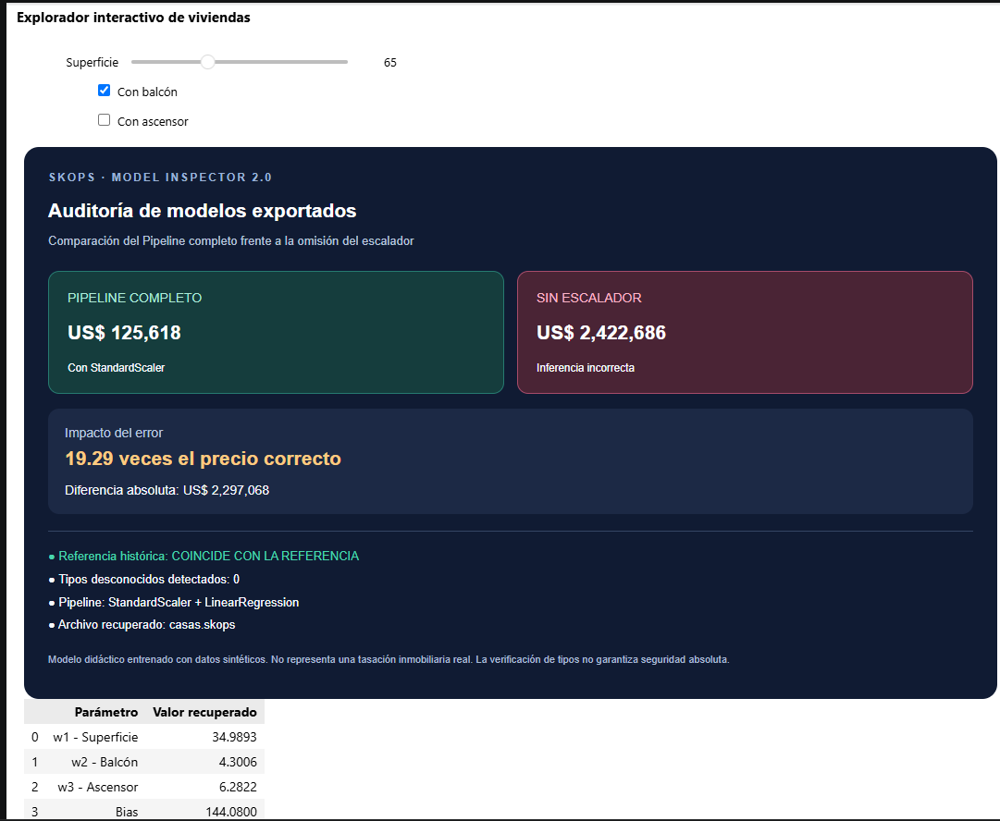

# Clase 10 — Del dataset al modelo exportado

**Seminario de Actualización | IFTS N.º 18**  
**Autora:** Fernanda Fava

## Objetivo

Comprender el proceso de entrenamiento de un modelo de Machine Learning, desde la preparación de los datos hasta su evaluación, exportación y recuperación.

## Desarrollo

Se trabajó con un dataset sintético de 200 viviendas, utilizando superficie, balcón y ascensor para estimar precios.

Se implementaron y compararon cuatro enfoques: LinearRegression, SGDRegressor, PyTorch y Keras.

Los modelos obtuvieron resultados similares sobre los datos de prueba, con un R² de 0,982 y un RMSE cercano a US$ 4.400.

## Investigación individual: skops

Se investigó el formato `skops` de scikit-learn para guardar y recuperar un Pipeline completo.

Se comprobó que el archivo conserva tanto los parámetros del modelo como los valores aprendidos por StandardScaler, permitiendo realizar predicciones sin volver a entrenar.

También se analizaron los controles de seguridad disponibles durante la carga.

## Bonus — Skops Model Inspector 2.0

Se desarrolló un simulador interactivo con ipywidgets para auditar el modelo recuperado y demostrar el impacto de omitir el preprocesamiento.

Para una vivienda de 65 m² con balcón y sin ascensor:

| Escenario | Predicción |
|---|---:|
| Pipeline completo | US$ 125.618 |
| Regresor sin escalador | US$ 2.422.686 |

El experimento demuestra que un modelo puede ejecutar una predicción sin errores de programación y, aun así, producir resultados incorrectos si recibe datos en una escala diferente de la utilizada durante el entrenamiento.

**Nota:** los datos son sintéticos y las predicciones no representan tasaciones inmobiliarias reales.

## Tecnologías

Python, NumPy, pandas, Matplotlib, scikit-learn, PyTorch, Keras, skops e ipywidgets.

## Reproducción

Abrir `Clase_10_Notebook_Camino_Entrenamiento.ipynb` en Jupyter o VS Code, instalar las dependencias indicadas y ejecutar las celdas en orden.

El simulador requiere `modelos_exportados/casas.skops`, generado en la actividad de exportación. Los controles interactivos no funcionan directamente desde la vista estática de GitHub.

## Conclusión

Esta actividad permitió comprender que el entrenamiento es solamente una parte del ciclo de vida de un modelo. Para utilizarlo correctamente también es necesario evaluar sus resultados, conservar las transformaciones y verificar que la exportación y recuperación funcionen como esperamos.
